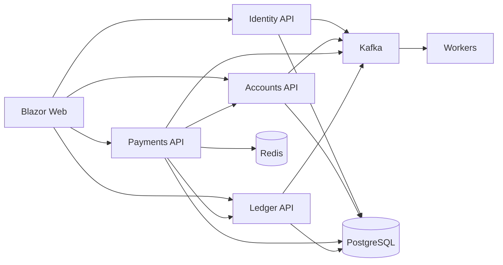

# LedgerX

An educational simulation of how a digital bank could keep its books, written in C# on .NET 10, for engineers and interviewers who want to see double-entry accounting, idempotent payments and an event outbox working end to end.

It is not a regulated bank, is not connected to Faster Payments, SEPA or cards, and must never be used with real money.

> The repository is called `digital_marketing` but contains LedgerX. The name is kept as it is.

## What it does

- Register, login and profile (ASP.NET Core Identity + JWT)
- Current and savings accounts with simulated UK-style numbers
- Demo deposits and withdrawals
- Internal transfers with a real state machine
- Double-entry journals (`SUM(debits) == SUM(credits)` or the post is rejected)
- Reversals instead of editing posted lines
- `Idempotency-Key` on money movement
- Concurrent spend protection (`SELECT FOR UPDATE` + Redis lock)
- Transactional outbox to Kafka
- Immutable audit records
- Customer Blazor UI and operations UI (ledger explorer, failed payments, health)
- OpenAPI and Scalar per API, OpenTelemetry hooks, liveness and readiness

## How it works

### Architecture



Service boundaries exist so Payments cannot quietly mutate a balance column. Money moves when the **ledger** accepts a balanced journal.

### Technology stack

| Area | Choice |
| --- | --- |
| Runtime | .NET 10 LTS, C# latest |
| APIs | ASP.NET Core minimal APIs, OpenAPI, Scalar |
| Data | EF Core 10, PostgreSQL, Npgsql |
| Auth | ASP.NET Core Identity, JWT bearer |
| Messaging | Confluent.Kafka, transactional outbox |
| Cache and locks | StackExchange.Redis |
| UI | Blazor Server |
| Observability | OpenTelemetry, health endpoints, `LedgerX` meter |
| Tests | xUnit, FluentAssertions, Testcontainers, NetArchTest |
| Local | Aspire AppHost + Docker Compose |

### Domain model

- `Customer`, `BankAccount`, `Beneficiary`
- `Transfer` and `Payment` with `Created`, `Validated`, `Processing`, `Completed` (plus Rejected, Failed and Cancelled)
- `Journal`, `LedgerLine`, `LedgerAccount`
- `Money` + `Currency` (`GBP` default, also `USD`, `EUR`), never `double`
- `IdempotencyRecord`, `OutboxMessage`, `AuditRecord`

Customer money is a **liability**. House cash is an **asset**. An internal transfer does **not** touch cash; it reassigns the bank's liability from Alice to Bob.

### Double-entry

```text
Deposit £100
  Dr ASSET:CASH                 100
  Cr LIAB:CUSTOMER:{account}    100

Transfer Alice to Bob £50
  Dr LIAB:CUSTOMER:{alice}       50
  Cr LIAB:CUSTOMER:{bob}         50
```

If those two lines do not match, `Journal.Post` throws `unbalanced_journal`.

**Frozen accounts:** outbound transfers and withdrawals are blocked. Incoming credits are allowed so a freeze cannot trap salary or an inbound transfer. Documented here and in `docs/CONCURRENCY.md`.

### Event architecture

Events are versioned envelopes (`EventId`, `EventType`, `OccurredAt`, `CorrelationId`, `CausationId`, `Version`, `Payload`). Producers never talk to Kafka inside the business transaction. See `docs/adr/0003-kafka-outbox.md`.

## Quick start

You need the .NET 10 SDK (see `global.json`) and Docker.

```bash
docker compose up -d postgres redis kafka
dotnet restore LedgerX.slnx
dotnet build LedgerX.slnx -c Release
```

Then run each service in its own terminal:

```bash
dotnet run -c Release --no-build --project src/Identity/LedgerX.Identity.Api   # http://localhost:5101
dotnet run -c Release --no-build --project src/Accounts/LedgerX.Accounts.Api   # http://localhost:5102
dotnet run -c Release --no-build --project src/Payments/LedgerX.Payments.Api   # http://localhost:5103
dotnet run -c Release --no-build --project src/Ledger/LedgerX.Ledger.Api       # http://localhost:5104
dotnet run -c Release --no-build --project src/Web/LedgerX.Web                 # http://localhost:5100
```

You can also start everything with the Aspire host (`dotnet run --project src/LedgerX.AppHost`) or run the whole stack in Docker (`docker compose up --build`, web on 5100, Kafka UI on 8088). Those two routes were not checked in the run below.

Sign in at http://localhost:5100 as `demo.customer@ledgerx.local` with the development password `LedgerX-Demo-2026!`. Other demo users and a step by step walkthrough, including the API calls, are in [docs/DEMO.md](docs/DEMO.md).

## Verified run (1 November 2026, Linux, .NET SDK 10.0.403)

| Check | Result |
| --- | --- |
| Restore and build `LedgerX.slnx` | failed until 1 November because the solution file listed no projects; fixed, now 0 errors and 66 warnings (several are NuGet security advisories) |
| Domain, Application and Architecture tests | 14, 5 and 2 passed |
| Integration tests (Testcontainers) | pass in CI; on my test machine they time out starting containers, which is a limit of that machine |
| CI | failing since September for the same empty solution reason; green again after the fix |
| Start on an empty database | Accounts API crashed while seeding; fixed in a separate commit, then all five processes reported healthy |
| Demo transfer of £500 from Alice Current to Bob | `Completed`; Alice Current went from £5,000.00 to £4,500.00 |
| Same request again with the same `Idempotency-Key` | returned the same transfer id, no second movement |
| Posted journal | `totalDebits` 500.00, `totalCredits` 500.00, `isBalanced: true` |
| Blazor pages beyond the home page, Kafka events, workers | not checked in this run |

Journal lines from that transfer, read back from `GET /api/journals/{id}` on the Ledger API:

```text
Debit   LIAB:CUSTOMER:bbbbbbbb000100010001000000000001   500.00   Debit sender customer liability
Credit  LIAB:CUSTOMER:bbbbbbbb000100010001000000000003   500.00   Credit receiver customer liability
```

## Tests

```bash
dotnet test tests/LedgerX.Domain.Tests
dotnet test tests/LedgerX.Application.Tests
dotnet test tests/LedgerX.ArchitectureTests
dotnet test tests/LedgerX.IntegrationTests   # needs Docker
```

The integration tests start PostgreSQL with Testcontainers and check duplicate idempotency keys and concurrent overspend.

## Structure

| Path | What it is |
| --- | --- |
| `src/Identity`, `src/Accounts`, `src/Payments`, `src/Ledger` | one bounded context each, split into Api, Application, Domain and Infrastructure projects |
| `src/Workers` | audit, notification and projection workers that read Kafka |
| `src/Web` | Blazor Server customer and operations UI |
| `src/BuildingBlocks` | shared contracts, eventing (outbox and inbox) and shared kernel |
| `src/LedgerX.AppHost`, `src/LedgerX.ServiceDefaults` | Aspire host and shared service setup |
| `tests/` | domain, application, architecture and integration tests |
| `docs/` | demo, data model, concurrency notes, ADRs and known issues |

## Configuration

See `.env.example`. The development JWT signing key and demo password sit in `appsettings.json` for local use only, so override them anywhere else. PostgreSQL defaults to `localhost:5432` with user `ledgerx`, Redis to `localhost:6379` and Kafka to `localhost:9092`. Set `OTEL_EXPORTER_OTLP_ENDPOINT` to export traces and metrics.

## Security

- Identity password hasher (never hand-rolled)
- Role policies: Customer, SupportAgent, FinanceOperator, Administrator, Auditor
- Customers can only see their own accounts
- Administrators cannot skip journal balancing
- Rate limiting, security headers, problem details, request validation
- Logs must not contain passwords (audit sanitises payload text)

## Observability

- Correlation id middleware (`X-Correlation-Id`)
- OpenTelemetry traces and metrics when `OTEL_EXPORTER_OTLP_ENDPOINT` is set
- Meters: `ledgerx_transfers_total`, `ledgerx_transfers_failed_total`, `ledgerx_transfer_duration`
- `/health/live` and `/health/ready` on every process

## Limitations

- No real payment rails, KYC or sanctions screening.
- Internal endpoints between services (`/api/internal/*`) have no authentication. Fine for a local demo only.
- No EF migrations are committed; the schema is created on startup.
- `LedgerX.sln` is empty; use `LedgerX.slnx`.
- Some NuGet packages have published security advisories (OpenTelemetry OTLP exporter 1.14.0, SSH.NET 2024.2.0) and should be updated.
- Cross currency FX is out of scope.
- No screenshots yet.

More in [docs/KNOWN_ISSUES.md](docs/KNOWN_ISSUES.md). Design decisions are in [docs/adr](docs/adr), and build notes in [docs/BUILD_PROGRESS.md](docs/BUILD_PROGRESS.md).

## Status

A working learning project. It has no real users or money, and no performance numbers have been measured yet.

## Licence

There is no licence file yet, so by default all rights are reserved.

## Disclaimer

Not authorised by the FCA or any other regulator. Simulated account numbers use sort code `04-00-04` and mean nothing outside this repository.

More of my work: https://cv.omnitest.dev/
